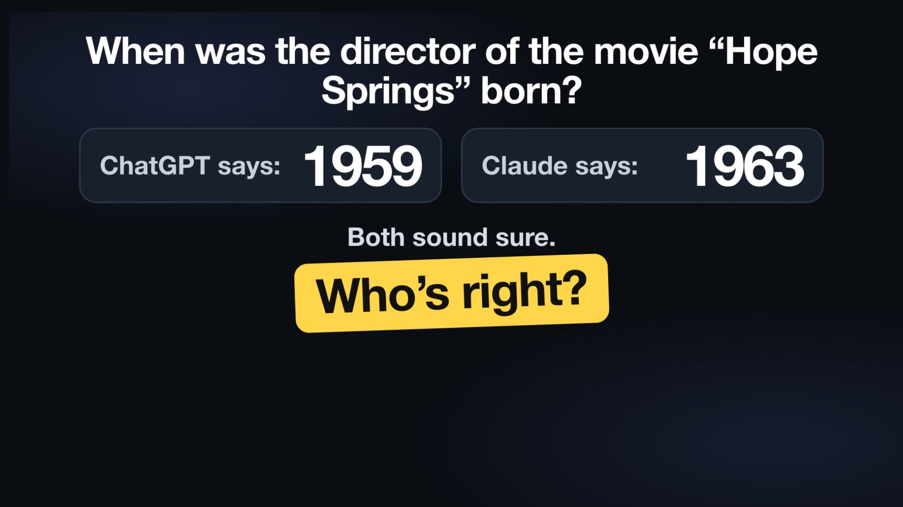

# ChatGPT × Claude — second opinion, one tap, free

**For the first time, your own ChatGPT and Claude apps work together on your phone — one tap, free.** **Poly Duo — ChatGPT + Claude on iPhone; a free pair of AIs on Android.** Nothing like this exists on phones yet: ChatGPT and Claude work as a pair, each answers on its own and then the answers are compared, on the accounts you already have. Free ones are enough. No card, no computer. You can run the strongest models of two companies together, and a paid plan adds no extra fee.

<!-- Poster: when video 2 is live on YouTube, point this link at the video instead of polyhelper.ai/duo. -->
[](https://polyhelper.ai/duo/)

**Install:** [iPhone — add the Duo shortcut](https://www.icloud.com/shortcuts/73ff6c2eddc540e0a04cc63db07bcb84) · [Android — Poly Duo on Google Play](https://play.google.com/store/apps/details?id=ai.polyhelper.a1) · [other languages](#install-in-60-seconds) · [polyhelper.ai/duo](https://polyhelper.ai/duo/)

## Install in 60 seconds

**Step 1 — apps.** On iPhone (iOS 18+) install the free **ChatGPT** and **Claude** apps and sign in to both once. No Claude yet? [Get the Claude app in the App Store](https://apps.apple.com/app/id6473753684) (about a minute). Free accounts are enough.

**Step 2 — shortcut.** Tap the iCloud link for your language below → the Shortcuts app opens → **Add**.

**Step 3 — first run: keep the phone in your hand.** iPhone asks about 5 times whether Duo may pass your question to ChatGPT and Claude, copy the result to the clipboard and write the journal file. Each time tap **Always Allow**: it applies only to Duo and only to your own apps, not to the rest of the phone. An unanswered prompt vanishes within seconds and the run ends with «no access» — then just run it again. After that there are no more prompts. **Then do not touch the screen for about a minute: a touch stops Duo.**

| Language | Duo | Trio |
|---|---|---|
| English | [Duo](https://www.icloud.com/shortcuts/73ff6c2eddc540e0a04cc63db07bcb84) | [Trio](https://www.icloud.com/shortcuts/ca730c3d887648a0a380dc397ede7ab7) |
| Español | [Duo](https://www.icloud.com/shortcuts/fe3a7b9b95304fe7998c62328903aa12) | [Trio](https://www.icloud.com/shortcuts/3180a49b17e64b35b9b7c3b445ba98e9) |
| Português | [Duo](https://www.icloud.com/shortcuts/eb3370375aed49ee99b289cf125ac1a5) | [Trio](https://www.icloud.com/shortcuts/29cace07d31f4033aa0cf26a2d1f9bb1) |
| Русский | [Duo](https://www.icloud.com/shortcuts/8c499582c0554dd0b965cafcf83ce26c) | [Trio](https://www.icloud.com/shortcuts/aaeeb82334154966b6c5fa6c8b6fdd3d) |
| Українська | [Duo](https://www.icloud.com/shortcuts/a13e303e51974957a09198cc22b8ad69) | [Trio](https://www.icloud.com/shortcuts/2ee4ec0be50e4e2c85c10626bd5adf01) |
| Deutsch | [Duo](https://www.icloud.com/shortcuts/8541f801cda446048dcc59f7cf98add5) | [Trio](https://www.icloud.com/shortcuts/3deb89385a604743925a2683faa0a216) |
| Français | [Duo](https://www.icloud.com/shortcuts/038b67254bf242a18a6d551e7eae4f1c) | [Trio](https://www.icloud.com/shortcuts/5debce283e1b4e4a90403959dbd8b748) |
| हिन्दी | [Duo](https://www.icloud.com/shortcuts/e964195237f040688facecea9e7dd9c2) | [Trio](https://www.icloud.com/shortcuts/8524e67391be4ced90d6bfddfc5fd271) |
| 日本語 | [Duo](https://www.icloud.com/shortcuts/f74fd5f56aa64321a2b63a954db0e647) | [Trio](https://www.icloud.com/shortcuts/c0988a5ff0f242cb8458f2991eef5b7f) |
| 한국어 | [Duo](https://www.icloud.com/shortcuts/ff7bff3172e34e43923a3ce16dea51dc) | [Trio](https://www.icloud.com/shortcuts/0df9f941045d4c3a8e43bef02c01c35b) |
| 中文 | [Duo](https://www.icloud.com/shortcuts/da642843a99841e0a35945873ca463a0) | [Trio](https://www.icloud.com/shortcuts/8c7639cf0be9421e884b075ee9b794e4) |

**Backup: the signed file.**

1. On your iPhone, open [`releases/`](releases) and pick your language — `en`, `es`, `pt`, `ru`, `uk`, `de`, `fr`, `hi`, `ja`, `ko` or `zh`.
2. Tap **`Duo.shortcut`** (or **`Trio.shortcut`**) → **Add**.
3. Run it once and tap **Always Allow** each time it asks about ChatGPT, Claude and the clipboard (4–6 times on the first run).

The same signed files are on [polyhelper.ai/duo](https://polyhelper.ai/duo/) (Duo 6.3) and in the [`releases/`](releases) folder of this repository (the same files that `releases/SHA256SUMS` lists). The [GitHub releases](https://github.com/vadimchernets/poly-duo/releases) page does not carry the current files: its only attached files, in v1.0.0–v1.0.4, are the old 1.0 builds named `Duo-en.shortcut` and so on. Do not use them: the name becomes the shortcut's name, and Siri and «another mode — same question» then cannot find it. Keep the file name
`Duo.shortcut`: the name in Shortcuts comes from it, and Siri and «another mode — same question»
find the shortcut by that name.

**If it doesn't work:** no «Ask Claude» in the action list — update the Claude app and iOS (18+). Empty answer — open the Claude app and check that you are signed in (no app yet: [App Store](https://apps.apple.com/app/id6473753684)), and open ChatGPT once. Duo stopped while you were scrolling — a touch of the screen stops it; run it again and wait a minute. ChatGPT says «logged out» — open ChatGPT, close it, run Duo again. The permission prompt vanished before you tapped — just run it again and tap **Always Allow** at once. More: [docs/en/install.md](docs/en/install.md#if-somethings-wrong).
## How it works

Ask ChatGPT → Ask Claude, blind → compare.

On iPhone, a Shortcut calls Ask ChatGPT, then Ask Claude — actions the two apps publish themselves. Answers pass between your own apps, with no server of ours and no API keys, on your own accounts. You get one checked answer on the screen and in the clipboard, in about a minute.

**What it is, technically:** a signed Apple Shortcut that chains the Ask ChatGPT and Ask Claude App Intents; it makes no network calls of its own, and `tools/verify.py` checks the signed files against `locales/`.

**Tip.** Pick the model you want in the Claude and ChatGPT apps. Duo takes whatever is set there.

Duo is free, and so is **Trio** (Duo plus a third voice, below). The code is open source (Apache-2.0): [source on GitHub](https://github.com/vadimchernets/poly-duo). Looking for Android? See [Android](#android). The **Poly A1** app ([Google Play](https://play.google.com/store/apps/details?id=ai.polyhelper.a1); on iPhone a beta on TestFlight, App Store soon) is free, installs Duo and Trio for you and walks you through every step.

Have ChatGPT and Claude? Start right away. Have one? It helps you install the other. Have neither? Gemini (Google) or Meta AI (WhatsApp, Facebook) helps you install both, free.

[](https://youtu.be/xljOlD4z1K4)

[](LICENSE)


<p align="center">
  
</p>

## Limitations

Worth knowing before you install:

- **iPhone only, iOS 18 or later.** iPad is expected to work on iPadOS 18+, but it is untested.
- **Free plans have limits.** Free Claude has a daily limit; free ChatGPT has its own. See the
  note at the end of this page.
- **A run takes about a minute**, closer to two in the multi-step modes.
- **It spends messages from your own plans**, not from an API budget.
- **Touching the screen cancels the run.** That's a limit of Apple's platform, not a choice we
  made. The one exception is **Clarify**, which opens its own window and asks you to answer.
- **You can't pick the model from inside Duo.** Each app uses the model set in it — choose it in the
  Claude and ChatGPT apps first, and check it before a run that matters.
- **Very long questions are risky.** The Claude action can time out and hand back an empty result
  while Claude keeps writing inside its own app; shorter questions return reliably.

## Build from source

```bash
./tools/build.sh            # every locale: build, sign, package, verify
./tools/build.sh en         # just one
python3 tools/verify.py     # checks only
```

Requires macOS (the `shortcuts` CLI signs the files) and Python 3.9+. The builders read
`locales/<lang>/` and write `dist/<lang>/`; `tools/verify.py` unpacks the signed result and
checks that it matches what the sources produce.

---

## Research and numbers

Poly Duo is built by the author of two papers on AI verification accepted at NeurIPS 2026 workshops. In our test of the October 2026 flagships (GPT-6.1 Sol + Claude Opus 5.5, run on 26 October 2026 through the companies' own command-line apps on regular subscriptions), when the two answered 100 new, never-published questions independently and agreed, they were right 97% of the time (72 of 74) — and on none of the 100 did both give the same confident wrong answer. In August 2026, on 1,459 public factual questions, the flagships of the day were right 98% of the time when they agreed (a re-analysis of our companion study's data).

Why "nothing like it": the multi-AI tools we found (search of 2026-10-25) need a server, your own API keys, credits or a computer. Details and sources: [docs/en/evidence.md](docs/en/evidence.md#who-else-does-this).

[](https://doi.org/10.5281/zenodo.23089503) Archived on Zenodo — concept DOI (all versions): [10.5281/zenodo.23089503](https://doi.org/10.5281/zenodo.23089503)

## Why a pair

Two AIs agreeing means little unless both are strong. In our data (a re-analysis of our companion study's data, 1,459 factual questions), when mid-tier models from OpenAI and Anthropic (GPT-5 mini + Claude Haiku 4.5, July 2026) agreed, they were right only 37% of the time; when the two companies' flagships (gpt-5.6-sol + claude-fable-5, 5 August 2026) agreed, 98% — and they made the same confident mistake on only 1 question in 100. Which models you can use is set by your plan — two $20 plans (ChatGPT Plus and Claude Pro) already give you access to GPT-6 Sol and Claude Opus 5.5.
Two measured pairs (different months and GPT reasoning settings); plans as of 26 October 2026 (claude.com/pricing, help.openai.com); plan pairs were not measured.

### The research behind it

Poly Duo builds on two papers accepted at NeurIPS 2026 workshops, on our October 2026 measurement of today's flagships, and on a re-analysis of our companion study's data. (0) October 2026 flagships (our measurement, 26 Oct 2026; channel: the vendors' own CLIs on regular subscriptions — Codex CLI, reasoning effort medium; Claude Code CLI, default — same frozen system prompt and answer parser as the August wave, one blind call per item, no web or tools, temperature not settable in either CLI). On a frozen set of 100 two-hop questions composed from Wikidata in August 2026 and never published, gpt-6.1-sol + claude-opus-5-5 agreed on 74/100; GPT's emitted answer was correct on 72/74 = 97.3% [Wilson 90.7, 99.3]; no item had both models confidently (≥ 80) giving the same wrong answer (0/100); GPT's confident-failure rate 4.0% → 1.4%. With claude-fable-5-1: coverage 78/100, emitted 76/78 = 97.4% [91.1, 99.3], shared confident failure on 1 item in 100. Alone on the same items: gpt-6.1-sol 95%, claude-opus-5-5 72%, claude-fable-5-1 77%. On a stratified 300-item SimpleQA subsample (297 graded for the Fable pair): emitted 96.3% (183/190, coverage 64.0%) and 97.9% (187/191, 65.0%), vs 98.0% for the August pair on the same items; on the full 106 WVA items (graded answers only): agreed answers correct 31/35 (with Opus 5.5) and 31/34 (with Fable 5.1); gpt-6.1-sol alone is 94.2% (98/104) there, so agreement adds little on these items. (1) Self-confidence is a weak signal (TAE workshop, doi:10.5281/zenodo.23197651): across nine API models of a 16-model blind collection (late July 2026; claude-haiku-4-5, gpt-5-mini, gemini-3.6-flash, grok-4-fast, deepseek-chat, qwen-plus, kimi-k3, glm-4.5, mistral-small-latest), stated confidence predicts a model's own correctness at AUROC 0.53–0.79; on the pre-specified headline panel (CN: DeepSeek, Alibaba, Moonshot), agreement with blindly elicited models reaches 0.83 vs 0.55 for self-confidence (Δ +0.29; 0.775 vs 0.545 under a label-free recoding). (2) Verification must be blind-first (Who Verifies the Agents? workshop, doi:10.5281/zenodo.23197641): in an exploratory conformity arm with six July 2026 API verifiers (Anthropic, OpenAI, Google, DeepSeek, Alibaba, Moonshot), verifiers that had disagreed blind endorsed the answer once shown it as a colleague's in 38.5% of cases (168/436); Poly Duo collects both answers blind before comparing them — in its default mode (Critique) and in Synthesis and Side by side. In the same paper, on the hardest quintile by population difficulty, the July 2026 API panels (one model per lab, labelled "frontier" there, budget/mid-tier for eight of nine) replicated 342 answers across 106 questions and, as originally graded, none was correct. (3) Post-hoc re-analysis (26 Oct 2026) of the released flagship-wave data of the companion study (doi:10.5281/zenodo.22166995; one flagship per lab, 5 Aug 2026 snapshot): the pair gpt-5.6-sol + claude-fable-5, 1,459 SimpleQA items, blind answers, GPT's answer emitted only on deterministic-equivalence agreement — coverage 69.6%, emitted answers correct 98.1% (985/1,004) [97.2, 98.9] vs 95.3% for GPT alone; confident-failure rate (conf ≥ 80, of confident answers) 4.6% → 1.9% for GPT and 10.3% → 2.8% for Claude; the two flagships made the same confident mistake on only 1 question in 100 (1.0%). On the 106 WVA items (hard for the July models) the flagship pair agreed on 37 and was right on 34. The mid-tier pair of the same labs (gpt-5-mini + claude-haiku-4-5, July 2026): coverage 8.6%, emitted answers correct 36.6%, 0/13 on the 106. A stronger pair wins on every practical axis: coverage ×8, emitted accuracy 37% → 98%, shared confident failures among emitted answers 8% → 1.5%. With ChatGPT Plus/Pro and Claude Pro/Max, Duo runs the strongest chat models those plans offer at no extra cost; figures in (0) are for the October 2026 pair measured through CLIs, figures in (3) for the 5 Aug 2026 pair.

Limits: SimpleQA is public, and gpt-5.6-sol echoes the gold string on 61.6% of answers; on the 106 items it is 95.2% correct alone and echoes gold on 64.2% — hard for July models, not for it. The gate removes a smaller share of GPT's confident failures than the mid-tier gate (70.8% vs 92.3%). Flagship vs mid-tier is two measured points (different months; GPT reasoning effort medium vs minimal). Pair figures describe blind answers compared afterwards, the scheme Poly Duo uses in Critique, Synthesis and Side by side; they are not a measured accuracy of any Poly Duo mode. The WVA zero holds under population difficulty; under leave-panel-out difficulty it persists for the cross-bloc panel (0/116), not pooled (78/354). Crediting the defensible answers found by WVA's manual gold adjudication moves that zero to at most 13/342 (lift 0.98×). The conformity arm's reverse-prompt control ran on six local models. On TAE's US panel, pooled self-confidence leads (0.84 vs 0.70), a between-model effect (0.67 rank-normalised). Claude runs the app's default model; ChatGPT runs with `model: auto`, which on paid plans picks the plan's model (on Plus chat as of 26 Oct 2026: GPT-6 Sol; GPT-6.1 Sol is in Codex and ChatGPT Work). The October measurement is one run through CLIs, n = 100 on the fresh set; it is not a measured accuracy of a Poly Duo mode. On the fresh set the August GPT arm ran via API at reasoning effort none, so August vs October is not compared there. Data and papers: github.com/vadimchernets/papers · polyhelper.ai/research

- **Verification Theater** (accepted at a NeurIPS 2026 workshop, «Who Verifies the Agents?»): [doi:10.5281/zenodo.23197641](https://doi.org/10.5281/zenodo.23197641) · [OpenReview](https://openreview.net/forum?id=Mg9RtDWcK4) · [NeurIPS](https://neurips.cc/virtual/2026/loc/sydney/173020)
- **Self-Confidence in LLM Evaluation** (accepted at a NeurIPS 2026 workshop, TAE): [doi:10.5281/zenodo.23197651](https://doi.org/10.5281/zenodo.23197651) · [OpenReview](https://openreview.net/forum?id=OyuZAAtv2q) · [NeurIPS](https://neurips.cc/virtual/2026/178299)
- **Companion study, Architectural Trust:** [SSRN](https://ssrn.com/abstract=7191261) · [doi:10.5281/zenodo.22166995](https://doi.org/10.5281/zenodo.22166995)
- All papers: [polyhelper.ai/research](https://polyhelper.ai/research/)

### What a second model catches

One model answering alone is confident about everything, including the parts it gets wrong. A
second model from another company, answering the same question on its own, slips in different
places — so where the two answers do not match, you see exactly what to check.

Poly runs on the Shortcuts actions the ChatGPT and Claude apps publish themselves, so a run
spends messages from your own plan, exactly like asking the question by hand.

**Use it when the answer matters.** Not for "what's the capital of France" — for the question
where being wrong is expensive: a contract clause, a diagnosis you're about to act on, a supplier,
a treatment, a piece of code going to production, a letter you can't unsend. People already do
this by hand — asking one AI, then another, then squinting at two tabs. Poly is that habit
without the tabs.

**And it keeps the argument.** When the two models disagree, Poly says so instead of averaging
them into one smooth paragraph: what each one claimed, which part is checkable, what to verify.
Two answers that matched independently are a stronger signal than either model's own confidence:
in our data on the 5 Aug 2026 flagships, the two made the same confident mistake on only 1 question
in 100. Agreement is still never presented as proof.

```
your question
     │
     ├──→  ChatGPT answers on its own
     │
     ├──→  Claude answers on its own, without seeing ChatGPT
     │
     └──→  Claude compares the two: matched / did not match / what to check
                    │
                    └──→  one final answer  →  screen · clipboard · journal
```

That's **Critique**, the default mode and the only one you need on the first day. Eleven other modes
put the two models against each other in different ways — a debate, a side-by-side, a map of
where they disagree — and they stay out of your way until you want them.

<details>
<summary>All twelve modes</summary>

| Mode | What happens | Cost |
|---|---|---|
| ⚖️ **Critique** | ChatGPT and Claude each answer without seeing the other; Claude compares both and delivers the final, opened by three blocks: matched independently / did not match / what to check yourself. Your default. | 3 messages |
| 🤝 **Debate to agreement** | ChatGPT and Claude each state a position without seeing the other, then argue up to 3 rounds until one concedes with a named reason; then where they agreed, what is still disputed, what is yours to decide. For life choices with no right answer. | 3–8 messages |
| 🩺 **Advisor** | Claude reviews *your own* text without rewriting it: verdict, strongest objection first. | 1 message |
| 👀 **Side by side** | Both answer independently, answers shown next to each other, nothing blended. | 2 messages |
| 🔀 **Synthesis** | Both answer blind, then one answer anchors the assembly and the other adds only what's missing. | 3 messages |
| 🧭 **Auto** | Not sure which mode fits? One classification call recommends one. | 1 + the mode |
| ⚔️ **Decision** | Fast view vs cautious view, then a referee: first steps, risks, confidence. | 3 messages |
| 🗺 **Dispute map** | Where the two agree, where they disagree, what is checkable — no verdict imposed on you. | 3 messages |
| 🥊 **Debate** | ChatGPT drafts, Claude answers on its own → ChatGPT compares and revises → judge. For the hard ones. | 4 messages |
| ❓ **Clarify** | The model asks you what's missing first, then answers. | 2 messages |
| 🎨 **Image** | Both draw the same brief blind as vector art; you get a gallery and pick. | 2–3 messages |
| ➕ **Delta** | Claude anchors, ChatGPT returns only what it would add. A cheap stand-in for Synthesis. | 2 messages |
| ℹ️ **What is Duo** | Built-in help, right inside the run. | free |

Six everyday modes sit in the main menu, the other six one tap away under **📂 More…** The ✉
badge on each entry shows the price (1–8 messages) before you choose. Which mode for which task:
[docs/en/recipes.md](docs/en/recipes.md).

</details>

## Trio — a third voice on a free key

**Trio** is the Critique pair plus a third AI from a third company. ChatGPT answers, Claude answers the
same question on its own without seeing ChatGPT's answer (the blind Critique scheme) — then a third
model reads the question and both independent answers and names **only the errors and gaps both of them missed**. If there are none, it says
so in one line («Nothing both missed»). One more Claude message then compares the three answers (matched
independently / did not match / what to check yourself, then the final answer); the third voice's words
come back as a separate block under it, never merged into it, and end with a confidence line.
Messages from your plans: ChatGPT 1, Claude 2.

```
ChatGPT answers · Claude answers blind → third voice (NVIDIA → Gemini → OpenRouter → Groq): only what both missed → Claude compares all three
```

- **Free.** The third voice runs on free keys, no card, in this order: NVIDIA (Kimi K3, GLM-5.3,
  DeepSeek V4.1 Flash — the strongest free models), Google AI Studio (Gemini Flash), Groq (Qwen,
  gpt-oss) and OpenRouter (its `:free` models and OpenRouter's free router). Save one or several; Trio walks every model of every key until one answers — a busy model or a spent daily
  limit moves on to the next, a key with no money or an invalid key is skipped.
- **Your own paid key (optional, for experienced users).** Trio also recognises paid keys by how
  they begin: `xai-` (Grok 4.7), `sk-ant-` (Claude Opus 5 → Sonnet 5), `sk-proj-`/`sk-` (OpenAI
  GPT-6 Astra → GPT-6.1 Sol; a `sk-` + 32 hex key is DeepSeek V4 Pro). Grok and DeepSeek go first, ahead
  of the free keys — a third company; Claude and OpenAI keys go after the free ones, since those
  companies already speak in the pair. You pay your provider directly; nothing passes through us.
- **The key stays out of the shortcut.** Trio asks for it once and saves it in iCloud Drive →
  Shortcuts → `poly-key.txt`. Sharing `Trio.shortcut` never shares a key.
- **Errors in plain words.** Only if every key and model failed does the block list what each one
  answered — no money left (402), limit (429), overloaded (503), invalid key (401) — and what to do.
  Claude's answer is already in the clipboard before the third voice is asked.
- File: `releases/<lang>/Trio.shortcut` (en, es, pt, ru, uk, de, fr, hi, ja, ko, zh). Getting the key: [docs/en/install.md](docs/en/install.md#trio--the-third-voice-free-key).

Trio is the one place where a free key buys a third company.

### Trio without a key

On an iPhone with Apple Intelligence (iPhone 15 Pro or newer, iOS 26 or later) there is a Trio whose third voice is Apple Intelligence through the Shortcuts action «Use Model». It needs no key and no sign-up. Links are in «Duo and Trio» above (English, Spanish, Portuguese, Deutsch, Français, 日本語, 한국어, 中文, हिन्दी). On any other iPhone use the free-key Trio.

## Duo and Trio

- **Duo** — the pair. ChatGPT and Claude each answer on their own, without seeing each other; then
  Claude compares the two and writes one answer, on the screen and in the clipboard, in about a
  minute. In the default mode, **Critique**, it opens with three blocks: matched independently /
  did not match / what to check yourself. Eleven more
  modes (debate to agreement, side by side, dispute map, decision, …) sit in the same menu or under
  📂 More… — twelve in all. Spends 1–8 messages from your own ChatGPT and Claude plans per run; the ✉ price is shown
  before you choose.
- **Trio** — Duo plus a third voice from a third company. ChatGPT and Claude answer separately, a free AI
  names only the errors and gaps both of them missed, then Claude compares all three and writes the
  final answer; the third voice's words come as a separate block under it. It runs on any **free** key — NVIDIA first (Kimi K3, GLM-5.3, DeepSeek V4.1 Flash), then
  Google AI Studio (Gemini), OpenRouter (its free models) or Groq — or several of them: Trio
  tries every key and every free model until one answers. Limits are counted per account, not per
  key, so extra keys help only when they come from different companies. Keys are never inside the shortcut: asked once on the first run and kept in your iCloud
  Drive (`Shortcuts/poly-key.txt`).
- **Trio without a key** — on an iPhone with Apple Intelligence (iPhone 15 Pro or newer, iOS 26+) the
  third voice can be Apple Intelligence on the phone: no key, no sign-up. Same install, a different
  file: [English](https://www.icloud.com/shortcuts/2a24e0157e4a445bae92ed1410907b9f) ·
  [Español](https://www.icloud.com/shortcuts/281f56b82f7444438220fdffcbb46f22) ·
  [Português](https://www.icloud.com/shortcuts/4000dcb2b9d64dcfaa44062c92e51b69) ·
  [Deutsch](https://www.icloud.com/shortcuts/ee32676281884deeba0868ced906c229) · [Français](https://www.icloud.com/shortcuts/5b368c5ebf2e45c1ad41702dd9692c90) · [日本語](https://www.icloud.com/shortcuts/92d37480faf44969882f992c08baba7a) · [한국어](https://www.icloud.com/shortcuts/99366127269947f285147e66af8109b9) · [中文](https://www.icloud.com/shortcuts/0a339cb1b3fd4ddea6b2ec40808debd9) · [हिन्दी](https://www.icloud.com/shortcuts/649c129fd8ba4551b42497a8d88317ac). Not for
  Russian or Ukrainian yet (no such file for them).

*In the sources the main shortcut is still called **Poly** — `tools/build.sh` writes
`dist/<lang>/Poly.shortcut`. C1M Duo is the same shortcut released under its own name, with «Poly»
changed to «Duo» in titles, menus, help and journal file names. The rest of this page says Poly
where it describes the sources.*

## Requirements

- iPhone on **iOS 18 or later** (iPad on iPadOS 18+ is expected to work, untested).
- The **ChatGPT** and **Claude** apps, installed and signed in.
- Your own ChatGPT and Claude accounts — free ones are enough: free Claude runs Sonnet 5.5 — the same
  Sonnet 5.5 as on the paid plan (paid plans also have stronger models); the Ask Claude action uses
  whichever model is set in your Claude app, and ChatGPT runs on `auto` (the app picks the model).
  Two $20 plans, ChatGPT Plus and Claude Pro, give you access to GPT-6 Sol and Claude Opus 5.5 at no
  extra charge from Duo; Duo uses the model each app picks (plans as of 26 October 2026).
- For **Trio**: any free key (no card) — [NVIDIA](https://build.nvidia.com/settings/api-keys) first
  (email, password, then an SMS code); no SMS? [Groq](https://console.groq.com/keys) or
  [Google AI Studio](https://aistudio.google.com/apikey) — sign in with your Google account, no
  phone needed; or [OpenRouter](https://openrouter.ai/keys) (turn on free models once in
  [privacy settings](https://openrouter.ai/settings/privacy), otherwise they answer «No endpoints
  found»). Several keys, one per line, help when they are from different companies — limits are
  per account, not per key. On the first run iPhone asks for permission 4–6 times — tap
  **Always Allow** each time.
- Don't touch the screen while it runs — that cancels the run on Apple's platform.

Docs in twelve languages: [English](docs/en/install.md) · [العربية](docs/ar/install.md) · [Deutsch](docs/de/install.md) · [Español](docs/es/install.md) · [Français](docs/fr/install.md) · [हिन्दी](docs/hi/install.md) · [日本語](docs/ja/install.md) · [한국어](docs/ko/install.md) · [Português](docs/pt/install.md) · [Русский](docs/ru/install.md) · [Українська](docs/uk/install.md) · [中文](docs/zh/install.md)

To build from source you need macOS (the `shortcuts` CLI signs the files) and Python 3.9+ — see
[Build from source](#build-from-source).

---

*In the sources the main shortcut is still called **Poly** — `tools/build.sh` writes
`dist/<lang>/Poly.shortcut`. C1M Duo is the same shortcut released under its own name, with «Poly»
changed to «Duo» in titles, menus, help and journal file names. The rest of this page says Poly
where it describes the sources.*

## Companions

Small single-purpose shortcuts that share the same engine. They are for people who build from source
(`tools/build.sh` → `dist/`); they are not in the iCloud links yet. They call the main shortcut by the
name «Poly», so rename yours to «Poly» or edit the Run Shortcut step in each companion.


- **Poly Voice** — tap, dictate, hear the final answer read back.
- **Poly Photo** — share a photo or PDF; the text is recognized on device, then answered.
- **Poly Quiet** — the Critique pipeline with no screens at all: clipboard and journal only.
- **Poly Compress** — shrink a long text with Apple's on-device model before the pair sees it.
  This one needs Apple Intelligence hardware (A17 Pro / M-series or newer); nothing else does.
- **Poly Multi** — the pair plus any other AIs you have, semi-manually: Poly writes the prompt,
  walks you through the apps and merges everything into one document; you paste, send and copy.
  Roughly half the work of doing it by hand. Built from source, like the other companions.

> **Want the full council rather than a pair?** Poly is the pocket edition of a larger method:
> **PolyHelper** asks up to ten AIs and merges them into one document with the disagreements kept —
> free, nothing to install, on any device. Poly Multi already merges by its canon.
> → **PolyHelper C1**: [polyhelper.ai](https://polyhelper.ai/).

## Android

**Duo inside Poly A1 (Google Play).** The free Poly A1 app runs the same pair automatically on a free key: one AI answers, one from another company checks (NVIDIA, Google AI Studio, Groq, OpenRouter — see «How it works»). It also shows «both agree / where they differ», «Find the mistake» and a debate to agreement, can use the AI on the phone itself, and is in 11 languages. With ChatGPT and Claude subscriptions on Android the path is by hand: Share → the other app → copy the answer back. Verified on an Android emulator on 2026-10-01, not on a real phone.

**Older path: Tasker (not tested on a device).** The same idea through **Tasker** and the clipboard: Tasker prepares the prompt, opens each app in turn and picks the answer up when you copy it. It is built and structurally verified, and nobody has run it on a real phone yet — if you try it, tell us what happened at info@polyhelper.ai. Files and guide: [android/](android/), [docs/en/android.md](docs/en/android.md).

## Languages

English is the base language. Everything a user sees — menus, notifications, prompts, journal
entries, docs — comes from `locales/<lang>/`, so a new language is a folder, never a fork of the
code.

Prompts are deliberately shared across all languages. The models read them, not you, and English
works best there — every locale uses `locales/en/prompts/` by default, and any language may
override a single prompt by dropping its own file into `locales/<lang>/prompts/` if it ever needs to.

All eleven shipped languages are built and verified against their sources — `python3 tools/verify.py` checks that every
shipped shortcut is what the locale files produce, and that every kit matches.

| Language | Locale | | Language | Locale |
|---|---|---|---|---|
| English (base) | `en` | | 日本語 | `ja` |
| العربية | `ar` | | Português | `pt` |
| Deutsch | `de` | | Русский | `ru` |
| Español | `es` | | 中文 | `zh` |
| Français | `fr` | | हिन्दी | `hi` |
| 한국어 | `ko` | | Українська | `uk` |

Verified against the source files is not the same as run on a phone. Two of the eleven have been
through a live iPhone with paid accounts, end to end, every mode but Debate to agreement; the other nine are built from
the same sources and machine-checked against them, but nobody has used them on a phone yet — if
you install one, telling us what broke is the most useful thing you can do.

How the languages are built: [BUILD.md](BUILD.md).

The *answer* always comes back in the language of your question, whichever locale you install —
the prompts instruct both models to follow the user's language.

## Privacy and cost

Your question goes to the two apps you already use, and the result stays on your phone. There is
no C1M server for it to reach — nothing is collected, and there is nothing to sign up for. The
journal (`Duo-journal.md`) is a plain text file in your own iCloud Drive; delete the journal
action or the file if you don't want a history. A paid iCloud plan is not required — without
iCloud the answer still reaches your screen and clipboard, only the journal is skipped.

Message consumption comes out of your own ChatGPT and Claude plans (free or paid), 1 to 8 per run (Critique 3, Debate to agreement 3–8, Advisor 1), from the
same allowance as your normal chats — and the ✉ badge in the menu tells you the price before you
pick a mode. The code is open source under the Apache License 2.0 — see [LICENSE](LICENSE).

## Verified

The demo above is a rendering of the interface — the labels come from the English locale and the
answer in the last frame is the real output of the run shown, copied from the phone. Every mode except Debate to agreement (added on
2026-10-07) was run end to end on a live iPhone with paid ChatGPT and Claude accounts —
both menu levels, the finale menu, the result screen, clipboard delivery, the journal and the
permission flow. That was one phone in two of the eleven languages; the other nine are built from
the same sources and machine-checked against them, and the old Tasker path for Android has never been run on a phone (the Poly A1 Android Duo was run on an emulator on 2026-10-01). Duo was also run end to end on free ChatGPT and Claude accounts (free Claude, Sonnet 5.5) on 2026-10-01.
`tools/verify.py` unpacks each signed shortcut and compares its prompts and texts with the open source files in `locales/`; it checks that the file matches the sources, not that the AIs answer well. Verified in the live run: Duo and Trio of 2026-10-01 (before Duo 5 / Trio 4); a fresh run on current iOS and app versions is still to be done and dated here. The blind Critique of Duo 6 / Trio 5 (2026-10-26) has not been run on a phone yet. Everything known to be unverified is in Limitations above and in the [FAQ](docs/en/faq.md).

Own check of the pair (26 Oct 2026, command-line models, blind grading against a reference): the Claude review made a correct ChatGPT draft wrong in 0 of 66 cases (95% CI 0-6%) and fixed ChatGPT's error in 18 of 18 cases on a set chosen for those errors; the blind variant against the earlier Critique: no difference established. Data and limits: [evidence/pair-check-2026-10-26/](evidence/pair-check-2026-10-26/README.md).

## Docs

[Install, step by step](docs/en/install.md) ·
[Start it with one tap: Siri, Back Tap, Lock Screen, Action Button](docs/en/launch.md) ·
[What C1M Duo is, in plain language](docs/en/what-is-c1.md) ·
[Recipes: which mode for which task](docs/en/recipes.md) ·
[Why a pair: the evidence, 2025–2026](docs/en/evidence.md) ·
[FAQ](docs/en/faq.md) ·
[Roadmap](ROADMAP.md) ·
[Changelog](CHANGELOG.md) ·
[Security policy](SECURITY.md) ·
[Building](BUILD.md)

## Feedback

The most useful thing you can send is not a star. Read this page for thirty seconds, then tell us
whether it was obvious what C1M Duo does, who it's for and how to run it. If it wasn't,
write to info@polyhelper.ai and say where you got lost — that's the feedback we can't
get any other way.

- **Discussions** — ideas, questions, proposals for new modes.
- **Issues** — bugs and concrete tasks, using the issue template.
- **Ran it on your phone?** Tell us what worked or broke with the [run report](../../issues/new?template=run-report.yml) (no question text needed); what has been seen so far is in [docs/en/compat.md](docs/en/compat.md).
- **Security** — please don't file a vulnerability as an issue; follow [SECURITY.md](SECURITY.md).

## Prior art / timestamps

- GitHub Release v1.0.0 (the first signed Duo and Trio, 5 languages, SHA-256; kept as a timestamp, not for download — the current files are in `releases/`): https://github.com/vadimchernets/poly-duo/releases/tag/v1.0.0 — 2026-10-01
- Software Heritage archive: `swh:1:snp:1da6fe462b3dc1729914fee2cef6331f44c87a3d` — https://archive.softwareheritage.org/browse/origin/?origin_url=https://github.com/vadimchernets/poly-duo
- Wayback Machine: [repository](https://web.archive.org/web/20261001170056/https://github.com/vadimchernets/poly-duo) · [release](https://web.archive.org/web/20261001170138/https://github.com/vadimchernets/poly-duo/releases/tag/v1.0.0) · [polyhelper.ai/duo](https://web.archive.org/web/20261001170120/https://polyhelper.ai/duo/)
- Earlier version: C1M, first published on GitHub on 1–2 September 2026.

## Legal

Poly is an independent product. It is not affiliated with, endorsed by, or sponsored
by OpenAI or Anthropic. "ChatGPT" and "Claude" are trademarks of their respective owners, used
here only to identify the apps Poly talks to. See [TRADEMARKS.md](TRADEMARKS.md).

Poly is a personal tool — not professional advice and not a fact-checker. Please read the
[disclaimer](DISCLAIMER.md) before relying on it for anything that matters.

Copyright 2026 Vadym Chernets. Licensed under the [Apache License 2.0](LICENSE); see also
[NOTICE](NOTICE) and [TRADEMARKS.md](TRADEMARKS.md). Apache-2.0 includes a patent grant to every user of this code (section 3 of the license). Any «patent pending» mention elsewhere concerns the PolyHelper method, not your right to use, change and share this code.

---

<sub>Free Claude has a daily limit. Ran out and you like Claude? Claude Pro ($20/month, $17 billed yearly; paid to Anthropic, not us) raises it a lot — at least five times more; Pro has a limit too. While you wait, a free AI from another company can check by hand: Gemini or Meta AI.</sub>
